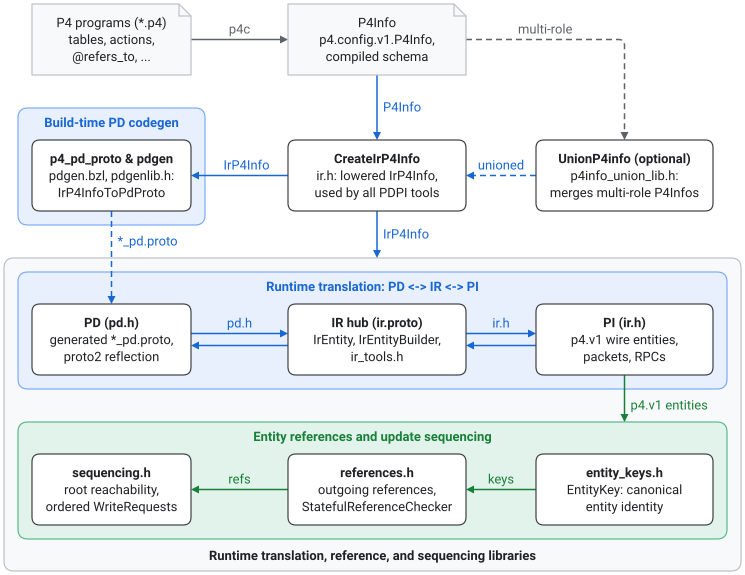

<!-- disableFinding(LINK_RELATIVE_G3DOC) -->

# PDPI atlas

Start with the overview below. Each page link goes deeper into one part.

Package [`//p4_pdpi`](../) translates P4Runtime entities, packet I/O messages,
and RPC requests, responses, and batch write statuses across three
representations:

*   Program-Independent (`PI`): wire `p4.v1` protos.
*   Intermediate Representation (`IR`): named fields and formatted strings
    derived from the `P4Info`.
*   Program-Dependent (`PD`): typed protos generated per P4 program.

It also provides build-time PD proto generation, `P4Info` unioning, reference
validation, and dependency-safe update sequencing. It is a pure, synchronous,
in-memory C++ library and Bazel codegen suite. Callers own P4Runtime gRPC
channels, switch state persistence, and transaction retries.

## System Context

*   **Inputs**: Compiled `p4.config.v1.P4Info` schemas (including `@refers_to`,
    `@referenced_by`, `@p4runtime_translation`, `@padding`, `@unsupported`, and
    `@group_mode_resource_guarantee` annotations), wire `p4.v1` entities, RPC
    messages, and `grpc::Status` payloads, and generated `*_pd.proto` messages.
*   **Outputs**: Validated `IrP4Info` schemas, canonicalized `PI`/`IR`/`PD`
    entities and RPC messages, generated `*_pd.proto` schemas, unioned `P4Info`
    protos across switch instantiations, concrete reference diagnostics, and
    dependency-ordered `p4.v1.WriteRequest` batches.

*   **Downstream consumers**: P4Runtime switch stacks and SONiC translators, SDN
    controllers, and P4 validation, fuzzing, simulation, and symbolic
    verification tools.

## Design Philosophy & Package Invariants

*   **`IR` is the single translation hub (`PD <-> IR <-> PI`)**: Every
    `PD <-> PI` conversion goes through `IR` instead of translating directly
    between generated PD protos and `p4.v1` wire messages.
    *   Wire validation and value formatting live once, on the `PI <-> IR`
        boundary.
    *   The `IR <-> PD` boundary maps `IR` fields onto generated PD protos by
        field name at runtime.
*   **Validated once into `IrP4Info`**: Callers compile a `p4.config.v1.P4Info`
    once into an `IrP4Info`. It indexes tables, actions, match fields, packet
    I/O metadata, reference edges, and topological table ranks. Translation,
    reference checking, and update sequencing read this validated `IrP4Info` and
    never re-validate the raw `P4Info` per call.
*   **Canonical `PI` byte strings vs. formatted `IR`/`PD` values**: Translating
    `PI -> IR -> PI` normalizes arbitrary `BITSTRING` values into P4Runtime's
    canonical representation (shortest non-empty big-endian byte string with
    leading zeros stripped). Reference validation and update sequencing compare
    raw `PI` byte strings, so callers that pass non-canonical `PI` entities
    silently miss reference and dependency matches.
*   **Explicit opt-in for partial, `@unsupported`, and unvalidated state**:
    Translation accepts only complete, supported P4Runtime entities by default.
    *   Callers opt in through `TranslationOptions` or `IrEntityBuilder` to
        key-only `DELETE` entries, `@unsupported` P4 elements, or unvalidated
        `IrEntity` construction.
    *   This keeps incomplete or experimental state out of switch writes unless
        a caller asks for it.

## Pages

*   **Entity and RPC translation**
    ([entity_and_rpc_translation.md](entity_and_rpc_translation.md)): Read
    before changing `IrP4Info` construction, `PI <-> IR <-> PD` entity, packet
    I/O, or RPC translation, `GrpcStatus` batch write status decoding,
    `TranslationOptions`, or `IrEntityBuilder`.
*   **PD proto generation and `P4Info` union**
    ([pd_codegen_and_p4info_union.md](pd_codegen_and_p4info_union.md)): Read
    before changing `pdgen` (`*_pd.proto` schema and field-number synthesis),
    the `p4_pd_proto` Bazel macro, or `UnionP4info` multi-instantiation `P4Info`
    merging and `@group_mode_resource_guarantee` unioning.
*   **Entity references and update sequencing**
    ([references_and_sequencing.md](references_and_sequencing.md)): Read before
    changing `@refers_to` / `@referenced_by` parsing, `EntityKey`, batch or
    stateful reference validation, root reachability, or dependency-ordered
    `WriteRequest` batching (complements the API walkthrough in
    [`references.md`](../references.md)).
*   **Agent workflows, commands, and pitfall checklist**
    ([`AGENTS.md`](../AGENTS.md)): Build, test, and golden update commands,
    conventions, and pitfall warnings. Coding agents load it automatically.
